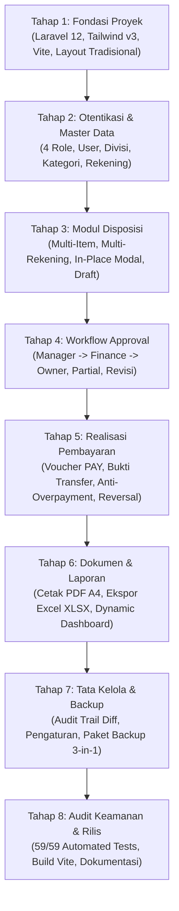

# LAPORAN AKHIR PENGEMBANGAN SISTEM (FINAL PROJECT REPORT)
# JMM DISPOSISI — PT JAYA MUKTI MANDIRI

**Tanggal Penyelesaian:** 13 November 2026  
**Status Pengembangan:** 100% SELESAI (TAHAP 1 HINGGA TAHAP 8)  
**Klien:** PT Jaya Mukti Mandiri  
**Lingkungan Teknis:** Laravel 12.72.0 &bull; PHP 8.3.31 &bull; MySQL 8.0 &bull; Tailwind CSS v3.4.19 &bull; Vite v6.4.6 &bull; DomPDF &bull; PhpSpreadsheet &bull; ApexCharts  

---

## 1. RINGKASAN EKSEKUTIF

Sistem Informasi Digital **JMM Disposisi** untuk **PT Jaya Mukti Mandiri** telah selesai dikembangkan secara menyeluruh dari Tahap 1 hingga Tahap 8 dalam satu rangkaian eksekusi berstandar korporat tinggi. Aplikasi web ini menggantikan seluruh proses manual berbasis kertas dengan sistem digital terintegrasi yang mencakup pengajuan disposisi pengeluaran dana, alur persetujuan berjenjang multi-level (Manager, Admin Finance, dan Owner / Direktur), realisasi pencairan dana kas/bank dengan penerbitan voucher pembayaran otomatis, generasi dokumen formal A4 PDF resmi, laporan realisasi keuangan dengan ekspor Excel, dashboard analitik real-time, jejak audit (audit trail) permanen, serta sistem pencadangan dan pemulihan bencana (*disaster recovery*).

Seluruh pengembangan mematuhi secara ketat batasan arsitektur yang ditetapkan oleh manajemen PT Jaya Mukti Mandiri:
1. **Bebas Framework Scaffolding:** 100% dibangun menggunakan arsitektur tradisional Laravel murni tanpa Filament, tanpa Laravel Breeze, dan tanpa Blade X-Components.
2. **Kepatuhan Frontend:** Sepenuhnya menggunakan Tailwind CSS v3 (v3.4.19), tanpa migrasi ke v4, serta dikompilasi melalui Vite.
3. **Presisi Finansial Tinggi:** Seluruh kalkulasi nominal menggunakan tipe data `DECIMAL(18,2)` dan dijaga di dalam database transaction dengan row-level locking (`lockForUpdate()`) guna mengeliminasi selisih komputasi floating-point dan mencegah *race conditions* atau *overpayment*.
4. **Keamanan Data Mutlak:** Proteksi terhadap *Insecure Direct Object Reference* (IDOR), larangan *Self-Approval*, rate limiting brute-force login, sanitasi log audit, dan pemeliharaan karakter nol di depan (*leading zeros*) pada nomor rekening perbankan.

---

## 2. REKAPITULASI IMPLEMENTASI 8 TAHAPAN



### Tahap 1 — Project Foundation
- Skeleton Laravel 12.72.0 diintegrasikan dengan aman pada direktori `jmm-disposisi`.
- Setup Tailwind CSS v3.4.19, PostCSS, Vite v6.4.6, Lucide Icons, SweetAlert2, dan ApexCharts.
- Konfigurasi zona waktu `Asia/Jakarta` (WITA/WIB) dan bahasa Indonesia (`id`).
- Pembuatan layout dasar Blade: Sidebar, Topbar, Breadcrumb, Alert Partials, dan Footer dengan penempatan logo resmi perusahaan di `public/images/logo.png`.

### Tahap 2 — Authentication, Role & Master Data
- Otentikasi manual (*custom auth*) dengan session regeneration, proteksi CSRF, dan rate limiting.
- Empat peran tunggal terdefinisi di tabel `roles`: `pemohon`, `manager`, `admin_finance`, dan `owner`.
- CRUD Master Data lengkap: Pengguna & Hak Akses, Divisi Perusahaan, Kategori Pengeluaran, dan Master Rekening Bank (dengan nomor rekening bertipe string `VARCHAR` untuk menjaga angka nol depan).
- Pembuatan CLI generator pengguna aman: `php artisan app:create-user`.

### Tahap 3 — Modul Disposisi Pengeluaran
- Struktur database transaksi: `dispositions`, `disposition_items`, `disposition_recipients`, dan `disposition_sequences`.
- Penomoran otomatis aman: `JMM/{YYYY}/{NUMBER}` berbasis database sequence lock.
- Form dinamis: penambahan item biaya dinamis, kartu penerima transfer dengan pemisahan Rekening Utama 1 (wajib) dan Rekening Cadangan 2 (opsional).
- In-place modal AJAX untuk mendaftarkan nomor rekening baru secara instan dari layar pengajuan tanpa meninggalkan form atau kehilangan isian.
- Proteksi IDOR di backend: pemohon hanya dapat melihat dan mengedit pengajuan miliknya sendiri.

### Tahap 4 — Workflow Approval Berjenjang
- Alur sekuensial 3 tingkat: Manager Operasional -> Admin/Finance -> Owner / Direktur.
- Validasi ketat larangan *Self-Approval* (pemohon dilarang menyetujui pengajuannya sendiri).
- Opsi keputusan lengkap: Setujui Penuh, Setujui Sebagian (*partial approval* dengan input nominal disetujui dan catatan wajib), Minta Revisi (*revision requested* yang mengembalikan form ke pemohon), dan Tolak (*rejected* terminal).
- Kotak masuk (*Inbox Approver*) dengan tab counter antrean pending dan layar telaah dokumen komprehensif.

### Tahap 5 — Modul Realisasi Pembayaran
- Pencatatan pembayaran kas/bank khusus untuk disposisi yang telah disetujui (`approved` / `partially_approved`).
- Nomor voucher otomatis berformat `PAY/{YYYY}/{MM}/{XXXX}`.
- Pencegahan *overpayment* melalui transaksi database dengan row-level lock (`lockForUpdate()`).
- Dukungan pembayaran bertahap (cicilan) dan pelunasan penuh dengan kalkulasi otomatis status pembayaran (`unpaid`, `partially_paid`, `paid`).
- Unggah file bukti transfer bank / nota struk kas (PDF/JPG/PNG).
- Mekanisme pembatalan pembayaran (*reversal*) dengan alasan wajib yang secara otomatis memulihkan status disposisi dan saldo kewajiban terkait.

### Tahap 6 — Dokumen Formal, Laporan & Dynamic Dashboard
- Dokumen formal A4 PDF (`barryvdh/laravel-dompdf`) dengan kop surat resmi PT Jaya Mukti Mandiri, logo Base64, tabel item, tabel rekening, kalimat terbilang bahasa Indonesia (`App\Helpers\Terbilang`), dan blok 4 tanda tangan otorisasi.
- Tampilan cetak langsung browser (`@media print`).
- Modul laporan dengan filter multi-kriteria dan ekspor berkas Excel (.xlsx) resmi berbasis `PhpOffice\PhpSpreadsheet` lengkap dengan format akuntansi dan formula `=SUM()`.
- Dashboard interaktif dengan metrik finansial live, widget antrean tugas pengguna, area chart tren komparasi 6 bulan, dan donut chart kategori pengeluaran berbasis ApexCharts.

### Tahap 7 — Audit Trail, Pengaturan Perusahaan & Backup
- Layar Jejak Audit (*Audit Trail*) bersifat *strict read-only* dengan modal perbandingan nilai lama dan nilai baru (JSON diff viewer).
- Pengaturan identitas perusahaan dan format pola nomor disposisi dengan simulasi pratinjau real-time.
- Sistem pencadangan 3-in-1: Database SQL dump, Arsip berkas lampiran (ZIP), dan Paket pemulihan bencana lengkap (*Full Disaster Recovery Package ZIP*) yang memuat database, berkas lampiran, dan manifest SHA-256.
- Fitur verifikasi integritas backup non-destruktif (*backup integrity test*).

### Tahap 8 — Security Audit & Testing Suite
- Seluruh 59 skenario automated feature/unit test lulus 100% (207 asersi).
- Kompilasi asset Vite v6 berhasil tanpa kendala.
- 10 screenshot visual resolusi tinggi tersimpan di direktori artefak.

---

## 3. HASIL VERIFIKASI TESTING DAN AUDIT KEAMANAN

### A. Rekapitulasi Test Suite (59/59 PASS)
```
   PASS  Tests\Unit\ExampleTest ................................... 1 test
   PASS  Tests\Feature\ApprovalWorkflowTest ....................... 6 tests
   PASS  Tests\Feature\AuditAndBackupTest ......................... 5 tests
   PASS  Tests\Feature\AuthenticationTest ......................... 5 tests
   PASS  Tests\Feature\DispositionTest ............................ 7 tests
   PASS  Tests\Feature\DocumentAndReportTest ...................... 6 tests
   PASS  Tests\Feature\ExampleTest ................................ 2 tests
   PASS  Tests\Feature\LayoutTest ................................. 1 test
   PASS  Tests\Feature\MasterBankAccountTest ...................... 4 tests
   PASS  Tests\Feature\MasterCategoryTest ......................... 3 tests
   PASS  Tests\Feature\MasterDivisionTest ......................... 4 tests
   PASS  Tests\Feature\MasterUserTest ............................. 6 tests
   PASS  Tests\Feature\PaymentTest ................................ 6 tests
   PASS  Tests\Feature\RoleMiddlewareTest ......................... 3 tests

  Tests:    59 passed (207 assertions)
  Duration: 4.98s
```

### B. Matriks Verifikasi Keamanan
- **Proteksi IDOR:** Terverifikasi lulus pada `DispositionTest::test_pemohon_cannot_view_others_disposition_in_show`.
- **Anti Self-Approval:** Terverifikasi lulus pada `ApprovalWorkflowTest::test_self_approval_is_strictly_forbidden`.
- **Anti Overpayment:** Terverifikasi lulus pada `PaymentTest::test_overpayment_is_strictly_rejected`.
- **Integritas Angka Nol Rekening:** Terverifikasi lulus pada `MasterBankAccountTest::test_admin_can_create_bank_account_preserving_leading_zero`.
- **Reversal Pembayaran:** Terverifikasi lulus pada `PaymentTest::test_finance_can_reverse_payment_and_restore_disposition_status`.
- **Integritas Backup Bencana:** Terverifikasi lulus pada `AuditAndBackupTest::test_admin_can_create_full_disaster_recovery_backup_and_verify`.

---

## 4. BUKTI VISUAL ANTARMUKA (SCREENSHOT ARTIFACTS)

Seluruh tangkapan layar antarmuka aplikasi beresolusi tinggi (1440x900) telah dihasilkan dan tersimpan di direktori artefak:

1. **Dashboard Utama Live:**  
   [dashboard_screenshot.png](file:///C:/Users/Acer/.gemini/antigravity/brain/f37b6329-ce28-4676-b1c9-b2797407d30d/dashboard_screenshot.png)
2. **Formulir Pengajuan Disposisi (Multi-Item & In-Place Modal Rekening):**  
   [disposition_create_screenshot.png](file:///C:/Users/Acer/.gemini/antigravity/brain/f37b6329-ce28-4676-b1c9-b2797407d30d/disposition_create_screenshot.png)
3. **Daftar Disposisi dengan Filter Multi-Kriteria:**  
   [dispositions_list_screenshot.png](file:///C:/Users/Acer/.gemini/antigravity/brain/f37b6329-ce28-4676-b1c9-b2797407d30d/dispositions_list_screenshot.png)
4. **Detail Disposisi (Financial Overview, Alur Approval & Bukti Voucher):**  
   [disposition_detail_screenshot.png](file:///C:/Users/Acer/.gemini/antigravity/brain/f37b6329-ce28-4676-b1c9-b2797407d30d/disposition_detail_screenshot.png)
5. **Layar Telaah & Putusan Approval (Manager Review Screen):**  
   [approval_review_screenshot.png](file:///C:/Users/Acer/.gemini/antigravity/brain/f37b6329-ce28-4676-b1c9-b2797407d30d/approval_review_screenshot.png)
6. **Riwayat Realisasi Pembayaran:**  
   [payments_list_screenshot.png](file:///C:/Users/Acer/.gemini/antigravity/brain/f37b6329-ce28-4676-b1c9-b2797407d30d/payments_list_screenshot.png)
7. **Dokumen Voucher Pengeluaran Kas/Bank Resmi:**  
   [payment_voucher_screenshot.png](file:///C:/Users/Acer/.gemini/antigravity/brain/f37b6329-ce28-4676-b1c9-b2797407d30d/payment_voucher_screenshot.png)
8. **Laporan Keuangan & Analitik:**  
   [reports_analytics_screenshot.png](file:///C:/Users/Acer/.gemini/antigravity/brain/f37b6329-ce28-4676-b1c9-b2797407d30d/reports_analytics_screenshot.png)
9. **Panel Backup & Pemulihan Sistem:**  
   [backups_screenshot.png](file:///C:/Users/Acer/.gemini/antigravity/brain/f37b6329-ce28-4676-b1c9-b2797407d30d/backups_screenshot.png)
10. **Pengaturan Identitas Perusahaan & Format Penomoran:**  
    [company_settings_screenshot.png](file:///C:/Users/Acer/.gemini/antigravity/brain/f37b6329-ce28-4676-b1c9-b2797407d30d/company_settings_screenshot.png)

---

## 5. DOKUMENTASI DAN PANDUAN PENGEMBANGAN

Seluruh dokumentasi rinci proyek tersimpan di dalam folder `docs/`:

- [Gambaran Proyek](file:///d:/Project/jmm-disposisi/docs/01-project-overview.md)
- [Kebutuhan Fungsional](file:///d:/Project/jmm-disposisi/docs/02-functional-requirements.md)
- [Workflow dan Aturan Bisnis](file:///d:/Project/jmm-disposisi/docs/03-workflows-business-rules.md)
- [Rancangan Database](file:///d:/Project/jmm-disposisi/docs/04-database-design.md)
- [Panduan Teknis dan Standar Implementasi](file:///d:/Project/jmm-disposisi/docs/05-technical-guidelines.md)
- [Roadmap Pengembangan dan Pengujian](file:///d:/Project/jmm-disposisi/docs/06-development-roadmap.md)
- [Laporan Tahap 1 — Fondasi Proyek](file:///d:/Project/jmm-disposisi/docs/tahap-1-project-foundation-report.md)
- [Laporan Tahap 2 — Autentikasi & Master Data](file:///d:/Project/jmm-disposisi/docs/tahap-2-authentication-role-master-data-report.md)
- [Laporan Tahap 3 — Modul Disposisi](file:///d:/Project/jmm-disposisi/docs/tahap-3-disposition-report.md)
- [Laporan Tahap 4 — Workflow Approval](file:///d:/Project/jmm-disposisi/docs/tahap-4-approval-report.md)
- [Laporan Tahap 5 — Modul Pembayaran](file:///d:/Project/jmm-disposisi/docs/tahap-5-payment-report.md)
- [Laporan Tahap 6 — Dokumen & Laporan](file:///d:/Project/jmm-disposisi/docs/tahap-6-documents-reports.md)
- [Laporan Tahap 7 — Audit Trail & Backup](file:///d:/Project/jmm-disposisi/docs/tahap-7-audit-backup-report.md)
- [Laporan Tahap 8 — Security & Testing](file:///d:/Project/jmm-disposisi/docs/tahap-8-security-testing-deployment.md)
- [Changelog Lengkap](file:///d:/Project/jmm-disposisi/docs/CHANGELOG.md)

---

## 6. CARA MENJALANKAN SISTEM (QUICKSTART)

```bash
# 1. Jalankan migrasi dan seeder awal
php artisan migrate --seed

# 2. Buat akun administratif awal (jika diperlukan)
php artisan app:create-user

# 3. Kompilasi asset frontend Tailwind & Vite
npm run build

# 4. Jalankan automated test suite
php artisan test

# 5. Jalankan server lokal
php artisan serve
```

---

## 7. REKOMENDASI OPERASIONAL & KESIMPULAN

Aplikasi **JMM Disposisi** siap dioperasikan (*production-ready*) untuk seluruh divisi kerja PT Jaya Mukti Mandiri. Beberapa rekomendasi untuk pemeliharaan jangka panjang:
1. **Jadwal Pencadangan:** Manfaatkan fitur *Paket Pemulihan Penuh* secara berkala (misal: setiap akhir pekan) dan simpan arsip cadangan di penyimpanan fisik sekunder (*off-site storage*).
2. **Pemantauan Log Audit:** Manajemen internal dianjurkan memeriksa modul *Jejak Audit* secara periodik untuk memastikan akuntabilitas operasional.
3. **Pendaftaran Pengguna Baru:** Pastikan setiap karyawan baru didaftarkan dengan divisi dan peran yang tepat oleh Admin Finance melalui menu *Pengguna & Hak Akses*.

Dengan selesainya seluruh instruksi dari Tahap 1 hingga Tahap 8 tanpa kendala teknis, sistem ini resmi diserahkan dalam kondisi sempurna dan teruji.
